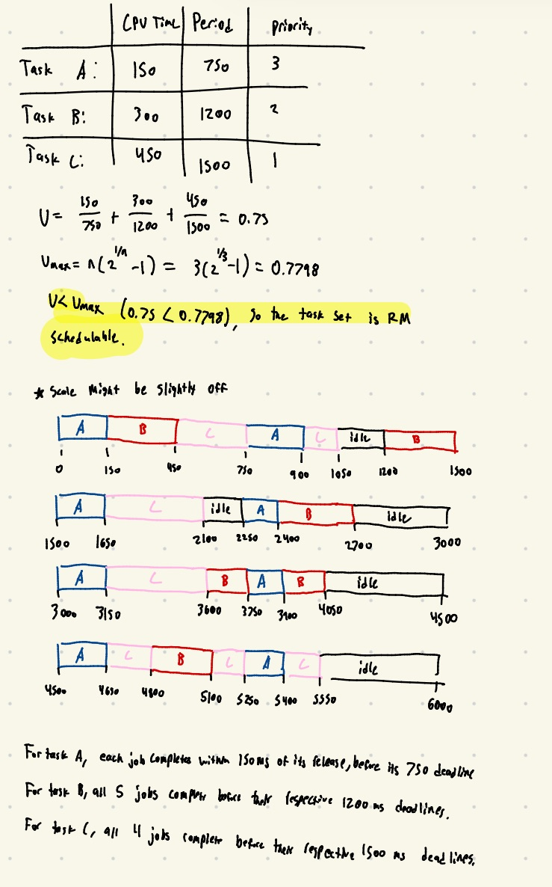
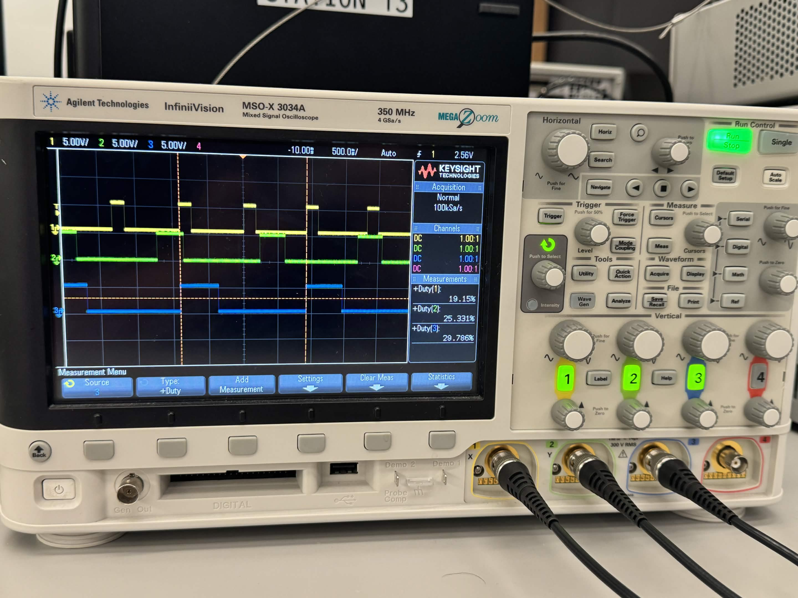

# ws5-rtos-skeleton

* Name: Eric Yao    
* GitHub username: eric-yaoza
* GitHub Repository URL: https://github.com/upenn-embedded/ese5190f26-ws1-yaoe.git
* Description of hardware: Laptop, Asus Zenbook. 

(R1) Is the task set above RM schedulable? Show your work. Draw out the scheduling diagram. If it is not schedulable, adjust Task B’s CPU time to make the set RM schedulable. 

If you can't read my handwriting:

U < Umax (0.75 < 0.7798), so the task set is RM schedulable (work shown above in screenshot).

For task A, each job completes within 150 ms of its release, before the 750 ms deadline. 

For task B, all 5 jobs complete before their respective 1200 ms deadline. 

For task C, all 4 jobs complete before their respective 1500 ms deadlines. 

(I1)oscilloscope image

The measured duty cycles were 19.15 for Task A, 25.331 for Task B, and 29.786 for task C, closely matching the expected values of 19.15%, 25.33%, and 29.79% respectively. Minor discrepancies can be due to measurement precision and timing overhead. 

Expected values calculated using equation D = (ON time in ticks)/(Period in ticks) * 100%. 

Task A: 9/47 * 100 = 19.15%
Task B: 19/75 * 100 = 25.33%
Task C: 28/94 * 100 = 29.79%